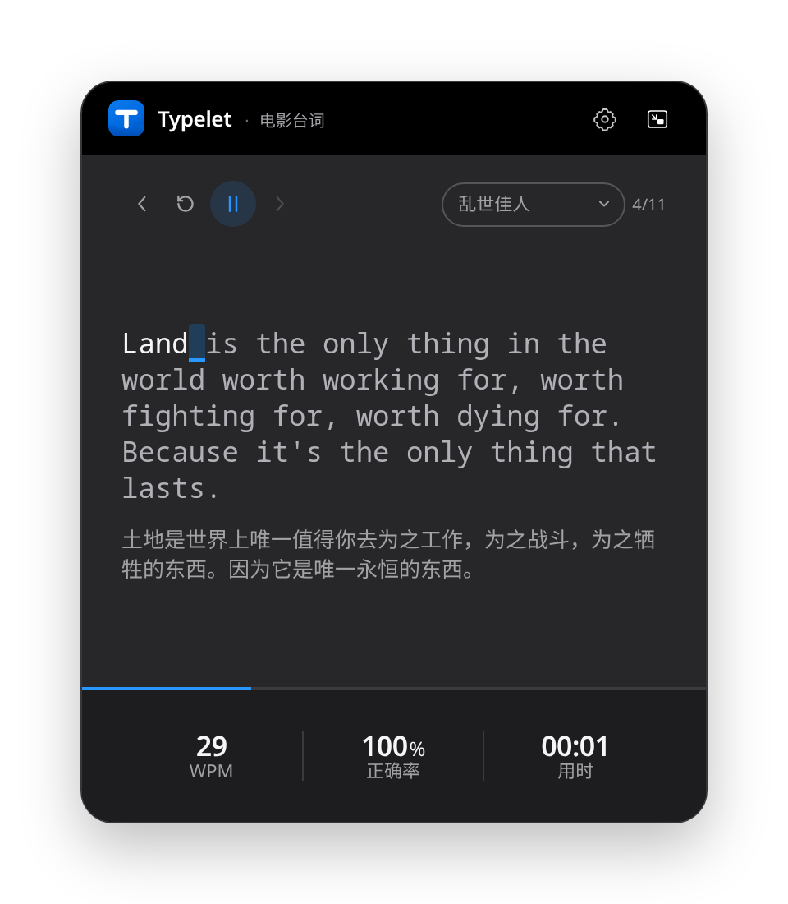
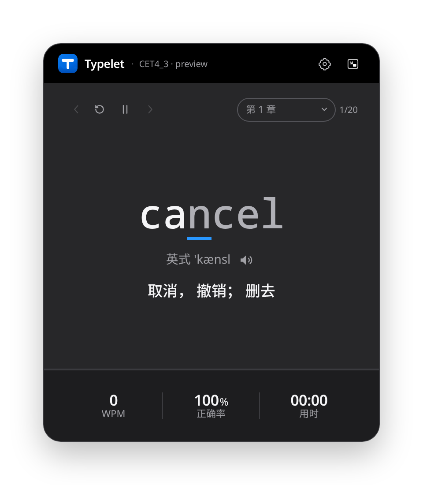
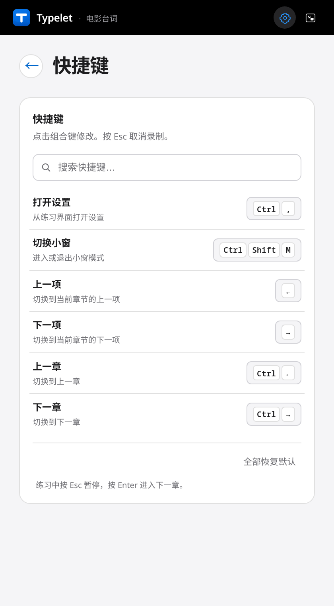

<div align="center">
  
  <h1>Typelet</h1>
  <p>等待 Agent 时，随手练一段句子或几个单词。</p>
  <p><a href="https://github.com/yexiaoye-blue/typelet/releases">下载安装</a> · <a href="#快速开始">快速开始</a> · <a href="docs/README.md">文档</a> · <a href="https://github.com/yexiaoye-blue/typelet/issues">问题反馈</a></p>
  
  <p><sub>深色网页预览 · 内置演示数据 · 非原生桌面截图</sub></p>
</div>

## 功能

- **句子与单词**：内置电影台词、CET4_3，支持导入文章和词表。
- **练习反馈**：输入标记、WPM、正确率、分章成绩与进度记忆。
- **桌面小窗**：工作间隙随时开始，离开窗口自动暂停。
- **按你的习惯**：可调整快捷键、字体、外观、朗读和按键音。
- **Agent 唤起**：Codex、Cursor 提交任务时自动显示应用。

## 下载安装

从 [Releases](https://github.com/yexiaoye-blue/typelet/releases) 下载与你的系统和架构对应的安装包。Preview 来自 `develop`，文件名标明来源提交。

| 系统 | 安装包 |
| --- | --- |
| Windows | `.msi` / `-setup.exe` |
| Fedora | `.rpm` |
| Debian / Ubuntu | `.deb` |
| 其他 Linux 桌面 | `.AppImage` |

当前提供 `x86_64`、`aarch64` 构建。macOS 暂无预编译包；Windows 安装包尚未配置发布签名。Linux Wayland 的置顶能力受 GTK 3 限制，详见 [平台边界](docs/design.md)。

<details>
<summary>Fedora：安装或升级本地 RPM</summary>

将 `typelet.rpm` 替换为下载的文件名：

```bash
sudo dnf install ./typelet.rpm
```

新版本使用 `install` 或 `upgrade`；`reinstall` 适用于已安装的同一版本。其他安装说明见 [使用指南](docs/getting-started.md)。

</details>

## 快速开始

1. 打开设置，选择「句子」或「单词」以及要练习的词本。
2. 点击开始或按任意键输入；拼对自动进入下一项，章末显示成绩。
3. 练习中按 `Esc` 暂停，章末按 `Enter` 开始下一章。

`Ctrl/⌘ + ,` 打开设置，`Ctrl/⌘ + Shift + M` 切换小窗。进入「设置 → 快捷键」可以自定义组合键。

## 精选界面

<table>
  <tr><th>单词练习</th><th>快捷键设置</th></tr>
  <tr>
    <td valign="top"><a href="docs/images/word-practice.png"></a></td>
    <td valign="top"><a href="docs/images/shortcuts.png"></a></td>
  </tr>
</table>

点击图片可查看原图。更多操作、[快捷键入口](docs/images/settings-shortcuts-entry.png)、[导入格式](docs/importing.md)和[数据保存](docs/getting-started.md)见文档。

## 本地开发

网页预览需要 Node.js 24 或更新版本：

```bash
npm ci
npm run web:dev
```

打开 **http://127.0.0.1:6670/**。网页使用独立的演示进度，不读写桌面词本；不模拟原生窗口、文件导入或 Agent 配置写入。

桌面开发另需 Rust stable 和当前系统的 WebView 依赖，使用 `npm run dev` 启动。检查使用 `npm test`、`npm run build`。技术栈为 Tauri 2、Svelte、TypeScript 和 Rust；系统依赖与打包步骤见 [产品与技术范围](docs/design.md)及 [CI 构建脚本](.github/scripts/build-rpm.sh)。

## 贡献与文档

欢迎通过 [Issues](https://github.com/yexiaoye-blue/typelet/issues) 报告问题或讨论改进。提交修改前请运行相关检查；界面改动附上可复现步骤和截图。

[使用指南](docs/getting-started.md) · [导入说明](docs/importing.md) · [文档索引](docs/README.md) · [产品范围](docs/design.md) · [后续规划](docs/roadmap.md)

仓库目前未包含独立的 `LICENSE` 文件。内置词本与音色来源、使用边界见 [内容来源](docs/getting-started.md#内容来源)。
