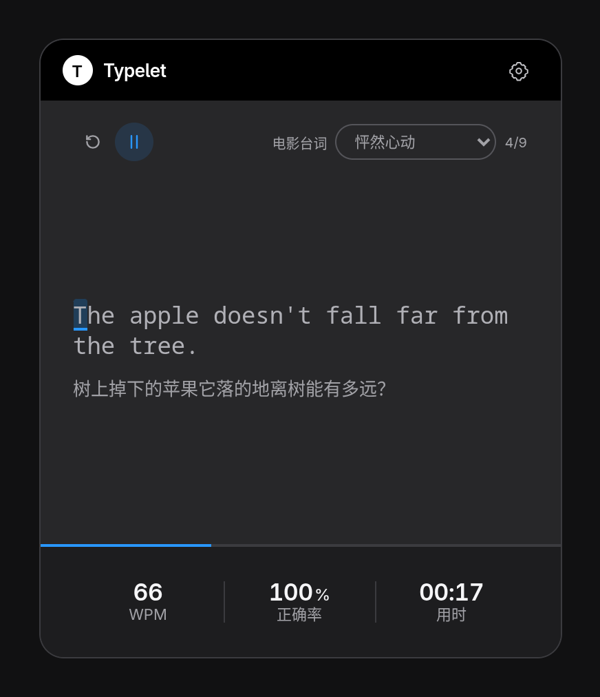

# Typelet

一个小巧的跨平台桌面悬浮打字工具。等待 Agent 完成任务时，随手练一段句子或单词。

A small cross-platform typing window for the time you spend waiting on an agent.

## 当前功能

- 悬浮窗默认 380 × 450，可拖动、置顶。已经在运行时再次启动，会唤起原来的窗口。
- 句子和单词两种模式。句子按电影或导入的文章分章；单词按每 20 个词一章。
- 句子内置电影台词，带中文释义。单词内置 CET4_3，显示音标和释义。
- 拼对后自动进入下一项。本章最后一项完成后暂停，显示本章的 WPM、正确率、用时，并放一次彩屑。回车或「下一章」进入下一章并开始。
- 单词可在开始时朗读，拼对后读下一个。口音可选英音或美音，优先使用有道读音，失败时改用系统语音。这个行为可以在设置里关掉。
- 设置里可以换按键音色，并分别调整朗读和按键音的音量。按键音只在输入练习文字时播放。音色来自 Qwerty Learner 使用的 kbsim 录音。
- 未开始或暂停时，练习区会模糊，并提示按任意键继续。窗口失去焦点时自动暂停。
- 打到一句或一个词的末尾后，即使中间有错，也可以按回车进入下一项。
- 速度标成 WPM，按本章用时里的正确字符数计算，不是只算当前这一项。
- 词本有单独一页，可以切换预置内容、导入文章或词表，也可以移除导入的内容。
- 外观、界面语言和练习字体可跟随系统，也可手动选择。设置里可以打开 Codex、Cursor 的自动唤起；DeepSeek Harness 仍在等待可用的 hook。

右上角齿轮或按 `Ctrl + ,` 进入设置。练习正文不可选中。点击发音按钮后，焦点会回到输入区，可以直接继续打。

## 导入数据

导入在词本页完成：先预览，确认后才写入本机。网页预览不能模拟文件选择。桌面端把导入结果和当前练到的条目记在应用数据目录的 `content.json` 里，不保存打到一半的按键。

### 句子

UTF-8 纯文本，扩展名 `.txt`。一个文件是一篇文章，文件名作为标题。不使用 JSON 或表格包装。

解析时去掉 BOM，把换行收成空格，再按 `.` `!` `?` `。` `！` `？` 切句。小数点、`Mr.` `Mrs.` `Ms.` `Dr.` `Prof.` `Sr.` `Jr.` `St.` `vs.` `e.g.` `i.e.` `etc.` 不会被切开。句末的引号和括号留在当前句里。正文为空时导入失败。导入的文章整篇算一章。

~~~text
You have power over your mind—not outside events. Realize this, and you will find strength.

The happiness of your life depends upon the quality of your thoughts.
~~~

不直接导入 EPUB、PDF、DOCX 或 HTML。

### 单词

UTF-8 制表符分隔文本，扩展名用 `.tsv`，也接受 `.txt`。第一行必须是表头。

| 字段 | 必填 | 含义 |
| --- | --- | --- |
| name | 是 | 英文单词。不能为空，也不能包含空格 |
| trans | 否 | 释义。多个释义用 `；` 或 `;` 分开 |
| usphone | 否 | 美式音标 |
| ukphone | 否 | 英式音标 |

只接受这四个字段，字段顺序由表头决定。重复字段、缺少 `name`、某一行字段比表头多，都会报错并带上行号。同名单词保留第一次出现的那行，导入结果里会写出重复数量。没有词条时不导入。导入的词表同样每 20 个词一章。

~~~text
name	trans	usphone	ukphone
abandon	放弃；遗弃	əˈbændən	əˈbændən
ability	能力；才能	əˈbɪləti	əˈbɪləti
~~~

只有单词时可以只留 `name` 列：

~~~text
name
abandon
ability
~~~

不导入 Anki `.apkg`，也不把 Qwerty Learner 的 JSON 词库当作导入格式。

## 内置词本

电影台词来自知乎专栏《80 句经典英文电影台词》，按电影分成章节，数据在 `src-tauri/typing-core/data/movie_lines.json`。CET4_3 来自 [kajweb/dict](https://github.com/kajweb/dict)（数据来自有道 / 新东方），共 2607 个词，字段是 `name`、`trans`、`usphone`、`ukphone`。它只用于本机练习，不要原样再发布这份词书。

这两份 JSON 在打包时不会再被压缩空白。`cet4_3.json` 本来就是一行；`movie_lines.json` 也保持紧凑的一行，避免把缩进打进安装包。Rust 用 `include_str!` 原样编进程序，所以源文件的体积就是安装后占用的体积。

## 技术栈

- Tauri 2：窗口、置顶、单实例和打包。
- Svelte + TypeScript：界面和输入。
- Rust：切句、词表解析、匹配和统计。桌面练习以 Rust 的结果为准。
- Vite：网页预览。预览使用同一份内置数据的 TypeScript 回退，不模拟本机文件导入。

## 启动

需要 Node.js 24 或更新版本、Rust stable，以及当前系统的 WebView。Linux 读取字体还需要 Fontconfig 和 FreeType。

~~~bash
npm install
npm run dev
~~~

只开网页预览：

~~~bash
npm run web:dev
~~~

地址是 `http://127.0.0.1:5173/`。检查用 `npm test`。打 RPM：

~~~bash
npx tauri build --bundles rpm
~~~

包在 `src-tauri/target/release/bundle/rpm/`。

同一套界面和 Rust 核心用于 Windows、macOS 和 Linux，需要在对应系统上构建。macOS 和 Windows 的发布签名还没有配置。

## 目录

- `src/`：界面、样式和中英文文案。
- `src-tauri/`：桌面外壳、Rust 打字核心和内置词本。
- `packages/`：网页预览使用的 TypeScript 练习逻辑。
- `public/`：图标和内置字体。
- `docs/`：当前范围、规划和验证记录。
- `tests/`：TypeScript 测试。Rust 测试在 `src-tauri/typing-core/`。

[当前范围](docs/design.md) · [后续规划](docs/roadmap.md) · [验证记录](docs/validation.md)
