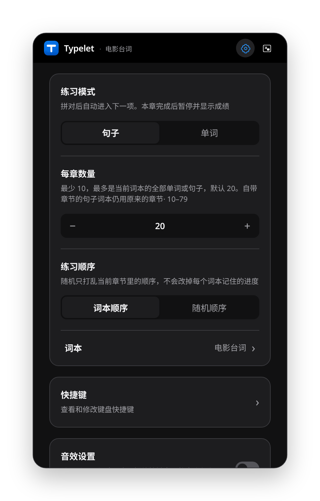

# 使用指南

安装、练习、设置和本机数据保存的详细说明。项目概览见 [README](../README.md)。

## 安装并开始

到 [Releases](https://github.com/yexiaoye-blue/typelet/releases) 选择与系统和架构对应的包。标有 Preview 的版本来自 `develop`，文件名带来源提交；正式版本由语义化版本标签发布。

| 系统 | 安装包 |
| --- | --- |
| Fedora | `.rpm`，选择 `x86_64` 或 `aarch64` |
| Debian / Ubuntu | `.deb`，选择对应架构 |
| 其他 Linux 桌面 | `.AppImage`；仍需满足运行库和桌面环境要求 |
| Windows | `.msi` 或 `-setup.exe`，选择对应架构 |
| macOS | 当前发布流程没有提供安装包，可在本机从源码构建；尚未配置发布签名 |

Fedora 可以用 DNF 安装或升级本地包。把下例的 `typelet.rpm` 替换为实际下载的文件名：

```bash
sudo dnf install ./typelet.rpm
```

升级到新版本时使用 `install` 或 `upgrade`。`reinstall` 用于重装已安装的同一版本，不能据此判断新版本已装好。

打开应用后，在设置中选择「句子」或「单词」及要练习的词本，点击开始或按任意键开始输入。拼对自动前进；本章完成后按 `Enter` 开始下一章。练习中按 `Esc` 暂停，再按任意键继续。应用再次启动时会唤起已有窗口。

## 设置和快捷键

右上角齿轮或默认快捷键 `Ctrl + ,` 打开设置；macOS 使用 `⌘ + ,`。向下滚动到「快捷键」，点击入口进入独立配置页。



点击组合键后直接按下新快捷键，按 `Esc` 取消录制。支持搜索、冲突提示、单项恢复及全部恢复默认；修改立即保存到本机。返回上一级时恢复原来的滚动位置和入口焦点。

| 操作 | 默认快捷键 |
| --- | --- |
| 打开设置 | `Ctrl/⌘ + ,` |
| 进入 / 退出小窗 | `Ctrl/⌘ + Shift + M` |
| 上一项 / 下一项 | `←` / `→` |
| 上一章 / 下一章 | `Ctrl/⌘ + ←` / `Ctrl/⌘ + →` |

练习中 `Esc` 暂停、章末 `Enter` 继续为固定操作。自定义快捷键仍需遵守当前系统和输入场景的限制。

其他设置包括明暗外观、中英文界面、练习字体、章节数量与顺序、英美音、自动朗读、朗读与按键音的独立音量及音色。静音会保留原音量；朗读优先使用有道读音，失败时使用系统语音。

桌面端可开启 Codex、Cursor 提交任务时自动唤起 Typelet，并查看应用写入的 hook 配置。Codex 首次可能要求确认 hook。DeepSeek Harness 仍待确认接入方式，当前不可用。

## 导入和保存

在「设置 → 词本」里管理预置和导入内容。桌面端先预览导入结果，确认后写入本机：

- 文章：UTF-8 `.txt`，按句末标点切分。
- 词表：UTF-8 `.tsv` 或 `.txt`，以制表符分隔，必须包含 `name` 表头。

字段、示例、重复词处理和格式边界见 [导入说明](importing.md)。当前不直接导入 EPUB、PDF、DOCX、HTML 或 Anki `.apkg`。

桌面端把导入内容、词本选择和练习位置保存在应用数据目录的 `content.json`；外观、声音、快捷键等偏好保存在本机 WebView 存储中，不保存打到一半的按键。Linux 默认数据目录为 `~/.local/share/dev.typelet.typing/`（遵循 `XDG_DATA_HOME`）。备份或迁移时先正常退出应用，再备份整个数据目录，而不只是 `content.json`。

## 平台边界

Linux 保留 GTK 为当前桌面选择的后端，也遵循显式的 `GDK_BACKEND`。GNOME Wayland 使用原生 Wayland；GTK 3 在该后端不支持置顶，因此置顶按钮会禁用并说明原因。支持置顶的桌面环境中可正常使用该按钮。

网页截图、测试通过或构建成功，都不等同于各系统的真实桌面、输入法、多显示器与窗口交互验收。当前边界和已有验证范围见 [产品与技术范围](design.md) 与 [验证记录](validation.md)。

## 内容来源

- CET4_3 来自 [kajweb/dict](https://github.com/kajweb/dict)，原始数据来自有道 / 新东方，共 2607 个词，仅用于本机练习，不原样再发布词书。
- 内置电影台词及中文释义见 [`movie_lines.json`](../src-tauri/typing-core/data/movie_lines.json)，来源记录在数据文件中。
- 按键音使用 Qwerty Learner 的 kbsim 录音。

[返回项目主页](../README.md)
